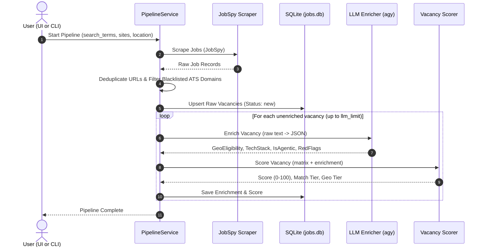
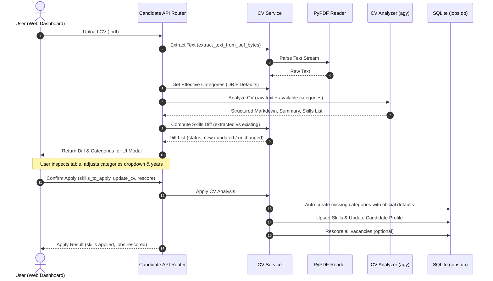

# Job Filter — System Design & Architecture Document

## 1. System Overview

**Job Filter** is an intelligent, automated job discovery and scoring system tailored for senior backend and AI/Agentic software engineers. It bridges the gap between raw web scraping and personalized job hunting by:

1. **Scraping** multiple job aggregators (LinkedIn, Indeed, Glassdoor) across target regions (e.g. Remote, EMEA, Worldwide).
2. **Filtering & Normalizing** URLs, detecting Applicant Tracking System (ATS) platforms, and managing domain blacklists.
3. **Enriching Vacancies with LLM** (via `agy` CLI) to extract structured insights: geographic eligibility (US-only vs. Global Remote), required tech stack, Agentic AI classification, compensation estimates, and company red flags.
4. **Scoring Vacancies Against Candidate Profile**: Evaluating vacancies against a customizable **Skills Matrix** with category-level multipliers, caps, negative penalty deductions, and geographic tier filters.
5. **AI-Powered CV Ingestion**: Parsing candidate PDF resumes, generating structured Markdown CVs, estimating years of experience per skill, mapping skills to weighted categories, and providing an interactive UI diff tool before committing to the database.

---

## 2. Architectural Principles & Layers

The project follows a clean **layered modular architecture**, maintaining strict separation between presentation, business logic, data persistence, and external integrations.

```
┌────────────────────────────────────────────────────────┐
│               Frontend Dashboard (SPA)                 │
│      (static/index.html + style.css + app.js)          │
└───────────────────────────▲────────────────────────────┘
                            │ REST API (JSON)
┌───────────────────────────▼────────────────────────────┐
│                  FastAPI Application                   │
│        (app.py -> job_filter/api/routers/*.py)         │
├────────────────────────────────────────────────────────┤
│                    Service Layer                       │
│    (pipeline_service, cv_service, skills_service)      │
├───────────────────┬────────────────┬───────────────────┤
│   Scraping Engine │  LLM Engine    │   Scoring Engine  │
│  (jobspy_scraper, │ (cv_analyzer,  │  (scorer, matrix, │
│     url_utils)    │   enricher)    │ category weights) │
├───────────────────┴────────────────┴───────────────────┤
│                  Repository Layer                      │
│   (jobs_repo, skills_repo, candidate_repo, blacklist)  │
├────────────────────────────────────────────────────────┤
│                   Database Layer                       │
│         (SQLite WAL Mode, schema.py, jobs.db)          │
└────────────────────────────────────────────────────────┘
```

### Layer Responsibilities

- **`api/` (Presentation Layer)**: Exposes RESTful endpoints grouped by domain (`jobs`, `candidate`, `skills`, `pipeline`, `system`). Validates HTTP payloads with Pydantic schemas.
- **`services/` (Business Logic Layer)**: Orchestrates end-to-end workflows:
  - `pipeline_service`: Controls scraping, deduplication, LLM enrichment, scoring, and status persistence.
  - `cv_service`: Handles PDF text extraction, skills diff calculation, and atomic CV/skill database updates.
  - `skills_service`: Coordinates skill matrix updates, category multipliers, and bulk rescoring of vacancies.
- **`scoring/` (Scoring Core)**: Pure, deterministic domain logic. Evaluates job descriptions against the active candidate skill matrix, calculating category points, penalties, and geographic tier classification.
- **`llm/` (AI Integration Layer)**: Interfaces with `agy` CLI to run LLM prompts (supports `gemini-3.8-flash`, `gemini-4-argon`, `claude-sonnet-5-5`, etc.). Handles JSON extraction, fallback parsing, and structured Pydantic schema validation.
- **`scraping/` (Data Acquisition Layer)**: Integrates `python-jobspy` to extract vacancies across job boards, normalizes URLs, and detects ATS board domains.
- **`repositories/` (Data Access Layer)**: Encapsulates all SQL queries to keep database interactions separate from business logic.
- **`db/` (Persistence Layer)**: Manages SQLite connection lifecycle, WAL mode pragmas, schema migrations, and default seed data.

---

## 3. Directory & Folder Structure

```
job-filter/
├── app.py                      # Uvicorn entrypoint for web server
├── start_app.command           # macOS one-click launcher (starts server + opens browser)
├── requirements.txt            # Production runtime dependencies
├── requirements-dev.txt        # Development & testing dependencies
├── jobs.db                     # SQLite database file (WAL mode)
│
├── job_filter/                 # Core modular Python package
│   ├── __init__.py             # Package declaration & version
│   ├── __main__.py             # CLI entrypoint (`python -m job_filter`)
│   ├── config.py               # Centralized configuration & environment variables
│   ├── logging_setup.py        # Rotating file & console logging configuration
│   │
│   ├── api/                    # FastAPI presentation layer
│   │   ├── __init__.py
│   │   ├── app.py              # FastAPI app factory, CORS, static mount, router inclusion
│   │   ├── deps.py             # Dependency injection (e.g. database connection per request)
│   │   ├── schemas.py          # Pydantic HTTP request models
│   │   └── routers/            # Endpoint routers
│   │       ├── candidate.py    # Candidate profile, CV PDF upload & diff application
│   │       ├── jobs.py         # Job listing queries, status updates, open URLs
│   │       ├── pipeline.py     # Background pipeline trigger & polling
│   │       ├── skills.py       # Skills & categories CRUD, rescoring, seed reset
│   │       └── system.py       # ATS domain blacklist CRUD, logs view
│   │
│   ├── db/                     # Database engine & migrations
│   │   ├── __init__.py
│   │   ├── connection.py       # SQLite connection factory & session context managers
│   │   ├── schema.py           # DDL schema definition & soft migrations
│   │   └── seed_data.py        # Single source of truth for default categories, skills & ATS
│   │
│   ├── llm/                    # Large Language Model integrations
│   │   ├── __init__.py
│   │   ├── agy_client.py       # Subprocess runner for `agy` CLI with robust JSON extraction
│   │   ├── cv_analyzer.py      # PDF CV analyzer prompt & extraction logic
│   │   └── enricher.py         # Vacancy enrichment prompt & JSON parser
│   │
│   ├── models/                 # Shared domain data models & schemas
│   │   ├── __init__.py
│   │   ├── cv.py               # Parsed CV models (ParsedSkillItem, ParsedCVResult)
│   │   ├── enrichment.py       # Vacancy enrichment models (VacancyEnrichmentResult, GeoEligibility)
│   │   ├── job.py              # Vacancy entity definitions
│   │   └── skills.py           # Matrix and category schemas
│   │
│   ├── repositories/           # Direct SQL database repositories
│   │   ├── __init__.py
│   │   ├── blacklist_repo.py   # ATS domain & company blacklist operations
│   │   ├── candidate_repo.py   # Candidate profile & CV markdown storage
│   │   ├── jobs_repo.py        # Job listings queries, inserts, filters
│   │   └── skills_repo.py      # Skill categories & candidate skills queries/mutations
│   │
│   ├── scoring/                # Deterministic scoring algorithm
│   │   ├── __init__.py
│   │   ├── matrix.py           # In-memory cached matrix provider & invalidator
│   │   └── scorer.py           # Score calculation (multipliers, category caps, penalties, geo)
│   │
│   ├── scraping/               # Web scraping & URL normalization
│   │   ├── __init__.py
│   │   ├── jobspy_scraper.py   # JobSpy multi-platform scraper integration
│   │   └── url_utils.py        # URL normalization, ATS domain resolution, hostname extraction
│   │
│   └── services/               # Application business workflows
│       ├── __init__.py
│       ├── cv_service.py       # PDF extraction, skills diffing, CV updates
│       ├── pipeline_service.py # End-to-end background pipeline execution
│       └── skills_service.py   # Skills management & vacancy bulk rescoring
│
├── static/                     # Single Page Application (SPA) web frontend
│   ├── index.html              # Dashboard UI layout (Tailwind CSS, dark mode)
│   ├── css/
│   │   └── style.css           # Custom animations, scrollbar & utility styling
│   └── js/
│       └── app.js              # Client state, dynamic tables, CV diff modal, API calls
│
├── tests/                      # Automated test suite (pytest)
│   ├── test_api_endpoints.py   # Integration tests for FastAPI endpoints
│   ├── test_llm_parser.py      # Tests for JSON extraction & schema parsing
│   ├── test_repositories.py    # Unit tests for database repositories
│   ├── test_scorer.py          # Unit tests for vacancy scoring & geo classification
│   ├── test_skills_diff.py     # Tests for CV skills diffing & category auto-creation
│   └── test_urls.py            # Unit tests for ATS domain extraction & normalization
│
└── docs/                       # Architecture & documentation
    └── design.md               # This document
```

---

## 4. Core Subsystems & Data Flow

### 4.1 Pipeline Execution Flow



### 4.2 Scoring Engine Mechanics

The scoring algorithm calculates a vacancy match score on a **0 to 100** scale based on a dynamic **Skills Matrix**:

$$\text{FinalScore} = \text{clamp}\left(\sum_{c \in \text{PositiveCategories}} \min(P_c, \text{MaxPoints}_c) - \sum_{k \in \text{PenaltyCategories}} \text{Penalty}_k - \text{GeoPenalty}, 0, 100\right)$$

#### 1. Skill Categories & Points Calculation
Each skill belongs to a category. Skills have an estimated `years_experience` and an assigned multiplier:
$$\text{SkillPoints} = \min(\text{round}(\text{years\_experience} \times \text{multiplier}), \text{max\_points})$$

Standard category definitions:
| Category ID | Title | Multiplier | Max Cap | Purpose |
|---|---|---|---|---|
| `ai_agentic` | 🤖 AI & Agentic Systems | **15.0x** | **30 pts** | Multi-agent frameworks, LangGraph, LLMs, RAG, MCP |
| `core_backend` | ☕ Core Backend & Languages | **2.0x** | **20 pts** | Primary backend languages (Java, Kotlin, Spring Boot) |
| `secondary_backend` | 🐍 Secondary Languages / TS | **3.0x** | **18 pts** | Scripting & secondary languages (Python, TypeScript) |
| `arch_infra` | 🏗️ Architecture & Cloud / DevOps | **2.0x** | **15 pts** | Kafka, Docker, Kubernetes, Microservices, Cloud, SQL |
| `domains` | 💼 Business Domains | **2.0x** | **10 pts** | FinTech, Banking, Payments, Trading |
| `alien` | 🚫 Alien Stack | **-1.0x** | **-20 pts** | Direct penalty for non-target stacks (Go, .NET, Rust, PHP) |
| `legacy` | 🦖 Legacy Stack | **-1.0x** | **-30 pts** | Heavy penalty for legacy systems (1C, SAP, Cobol) |

#### 2. Category Aggregation Rule
To prevent point inflation when a vacancy matches many minor skills in the same category, only the **highest-scoring matched skill** in each category is considered (`max()` over matched skills), capped at `max_points`.

#### 3. Geographic Tier Adjustment
- **`GLOBAL`**: Candidate is fully eligible to work remotely from any location. No penalty.
- **`RESTRICTED_US`**: Job strictly requires US citizenship, US residency, or US state presence. Capped at `score = min(score, 45)` and assigned `tier = 'US Only / Ineligible'`.
- **`RESTRICTED_EU`**: EU work authorization or specific European timezone required. Flagged accordingly.

---

### 4.3 CV PDF Ingestion & Skills Diffing Subsystem



1. **PDF Text Extraction**: Uses `pypdf` to extract text streams and cleans broken hyphenations (`word-\nwrap` $\to$ `wordwrap`).
2. **LLM Extraction**: `cv_analyzer.py` prompts the configured LLM via `agy` CLI to output valid JSON with:
   - Clean, normalized global English Markdown CV.
   - Concise candidate summary (in Russian).
   - List of all distinct technical skills with calculated years of experience and category mapping.
3. **Interactive Diff Tool**: The frontend displays a diff modal showing newly discovered skills (`new`), modified skills (`updated`), and unchanged skills (`unchanged`).
   - Each row provides a `<select>` dropdown populated with all system categories (`available_categories`).
   - Changing a skill's category or experience dynamically recalculates projected points on the client.
4. **Auto-Creation of Categories**: When applying changes, if a skill references a category not yet stored in SQLite, `cv_service.py` automatically initializes it using the official parameters from `DEFAULT_SKILL_CATEGORIES`.

---

## 5. Database Schema & Persistence

SQLite in **WAL (Write-Ahead Logging)** mode is used for fast concurrent reads and ACID-compliant writes.

### Key Tables

```
                    ┌──────────────────────────┐
                    │     skill_categories     │
                    ├──────────────────────────┤
                    │ PK  category_id          │
                    │     title                │
                    │     multiplier           │
                    │     max_points           │
                    │     sort_order           │
                    └────────────┬─────────────┘
                                 │ 1:N
                    ┌────────────▼─────────────┐
                    │     candidate_skills     │
                    ├──────────────────────────┤
                    │ PK  skill_id             │
                    │ FK  category_id          │
                    │     name                 │
                    │     years_experience     │
                    │     weight_points        │
                    │     is_primary           │
                    │     aliases_json         │
                    └──────────────────────────┘

┌──────────────────────────┐         ┌──────────────────────────┐
│    candidate_settings    │         │     blacklist_boards     │
├──────────────────────────┤         ├──────────────────────────┤
│ PK  id (always 1)        │         │ PK  domain_pattern       │
│     profile_text         │         │     reason               │
│     cv_text              │         │     created_at           │
│     updated_at           │         └──────────────────────────┘
└──────────────────────────┘

┌────────────────────────────────────────────────────────┐
│                        jobs                            │
├────────────────────────────────────────────────────────┤
│ PK  id                                                 │
│     site, job_url, title, company, location            │
│     date_posted, description                           │
│     enrichment_json (LLM analysis)                     │
│     score, match_tier, geo_tier                        │
│     user_status ('new', 'applied', 'saved', 'hidden')  │
│     created_at, updated_at                             │
└────────────────────────────────────────────────────────┘
```

---

## 6. API Design & REST Endpoints

The API is served by FastAPI at `/api/...`:

### Vacancies (`/api/jobs`)
- `GET /api/jobs`: Query vacancies with filtering (`user_status`, `min_score`, `search`, `geo_tier`, pagination).
- `GET /api/jobs/{id}`: Detailed vacancy info with raw description and LLM enrichment.
- `POST /api/jobs/{id}/status`: Update candidate review status (`new`, `applied`, `saved`, `hidden`).
- `POST /api/jobs/{id}/open-url`: Open the vacancy application link in the local desktop browser.

### Candidate & CV (`/api/candidate`)
- `GET /api/candidate`: Get profile summary and current CV markdown.
- `PUT /api/candidate`: Update profile text and CV markdown.
- `POST /api/candidate/upload-cv-pdf`: Upload PDF resume, extract text, run LLM analysis, return skills diff and available categories.
- `POST /api/candidate/apply-cv-analysis`: Commit confirmed CV text and selected skills to the database, with optional job rescoring.

### Skills & Categories (`/api/skills`)
- `GET /api/skills`: Retrieve complete skills matrix (categories + candidate skills).
- `POST /api/skills/categories`: Create or update a category (multiplier, max_points, title, sort_order) and automatically recompute skill weights.
- `DELETE /api/skills/categories/{category_id}`: Delete a category and its associated skills.
- `POST /api/skills/skills`: Create or update an individual skill.
- `DELETE /api/skills/skills/{skill_id}`: Delete a skill.
- `POST /api/skills/rescore-all`: Bulk re-run scoring across all vacancies in the database.
- `POST /api/skills/reset-default`: Reset categories and skills to standard seed data.

### Pipeline (`/api/pipeline`)
- `POST /api/pipeline/run`: Trigger asynchronous job search and enrichment pipeline in a background thread.
- `GET /api/pipeline/status`: Poll current pipeline progress (`idle`, `scraping`, `enriching`, `completed`, `error`).

### System & Blacklist (`/api/system`)
- `GET /api/system/blacklist`: List all blocked ATS domains and company rules.
- `POST /api/system/blacklist`: Add a domain or company to the blacklist.
- `DELETE /api/system/blacklist/{domain_pattern}`: Remove domain from the blacklist.
- `GET /api/system/logs`: Fetch recent rotating system log entries.

---

## 7. Frontend SPA Architecture

The frontend is implemented as a lightweight, reactive Single Page Application using vanilla JavaScript (ES6+), Tailwind CSS via CDN, and Lucide-style SVG icons.

Key components in `static/js/app.js`:
- **State Management**: Reactive state object storing active vacancies, filter parameters, current skills matrix, and active CV diff payload.
- **Internationalization (i18n)**: Native bilingual interface (English and Russian) with instant header switcher (`EN` | `RU`), data-attribute DOM localization (`data-i18n`), and persistent preferences in `localStorage`.
- **Interactive CV Diff Modal**: Renders candidate skills side-by-side with database records, providing inline `<select>` category pickers and numerical years inputs. Dynamic DOM updates ensure real-time score calculation before submission.
- **Matrix Manager Modal**: Allows adding, editing, and deleting categories and individual skills with instantaneous updates to category multipliers.
- **Toast Notification Engine**: User feedback mechanism for background job notifications and error alerts.

---

## 8. Configuration & Environment Variables

Job Filter works out-of-the-box with sensible defaults defined in [`job_filter/config.py`](file:///Users/vlad/IdeaProjects/job-filter/job_filter/config.py), but allows customization via environment variables:

| Variable | Default Value | Description |
|---|---|---|
| `JOB_FILTER_DB` | `jobs.db` | Absolute or relative path to the SQLite database file |
| `JOB_FILTER_MODEL` | `gemini-3.8-flash-low` | Active LLM model used by `agy` CLI (run `agy models` to view options) |
| `AGY_BIN` | Auto-detected | Path to the `agy` CLI executable (e.g. `~/.local/bin/agy`) |
| `JOB_FILTER_PORT` | `8000` | HTTP port for the web dashboard server |
| `JOB_FILTER_HOST` | `0.0.0.0` | Bind host for the web server |

### Operational Parameters
- **`TOP_SCORE_THRESHOLD`**: `70` — Vacancies with score $\ge 70$ are highlighted as **TOP Match**.
- **`GOOD_SCORE_THRESHOLD`**: `50` — Vacancies with score $\ge 50$ qualify as **Good Match**.
- **`JOB_ENRICH_TIMEOUT_SEC`**: `90s` — Maximum duration allowed per vacancy enrichment LLM call.
- **`CV_ANALYZE_TIMEOUT_SEC`**: `120s` — Maximum duration allowed for parsing full PDF resumes.
- **`LAST_OPENED_TTL_SEC`**: `1800s` (30 min) — Time window to bind a recently opened vacancy to ATS blacklist rules.

