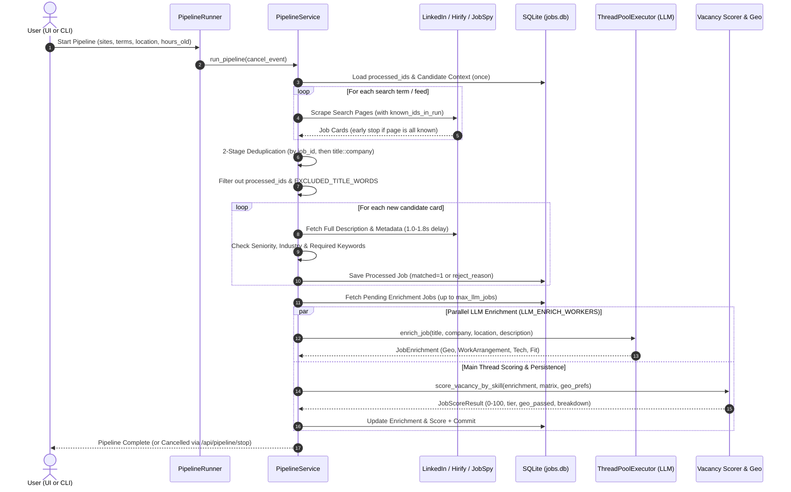

# Job Filter — System Design & Architecture Document

## 1. System Overview

**Job Filter** is an intelligent, automated job discovery, enrichment, and deterministic scoring system tailored for senior backend and AI/Agentic software engineers. It bridges the gap between raw multi-board scraping and personalized job hunting by:

1. **Scraping & Sourcing** multiple job aggregators (custom resilient LinkedIn Guest API scraper, Indeed, Glassdoor via `JobSpy`, and Hirify Agent REST API / Saved Feeds) across target regions (`EMEA`, `Remote`, `Worldwide`).
2. **Filtering & Normalizing** URLs, extracting external ATS links (`apply_url`) from job cards, detecting Applicant Tracking System (ATS) platforms, and managing domain/company blacklists.
3. **Parallel LLM Vacancy Enrichment** (via `agy` CLI with `ThreadPoolExecutor`) to extract structured insights: geographic eligibility (`candidate_geo_eligibility`), work arrangement (`remote_only`, `remote_or_hybrid_optional`, `hybrid_required`, `onsite_required`), location restrictions, required/nice-to-have tech stack, spoken language requirements, compensation details, and resume fit analysis.
4. **Deterministic Multi-Factor Scoring & Geo Filtering**: Evaluating vacancies against a customizable **Skills Matrix** (category multipliers, top-2 skill aggregation, `is_primary` core stack check, negative penalty stacks, title profile cap, freshness bonus) combined with a strict **Geographic & Remote Policy Classifier** (single-country locks, multi-country closed pools, EU/US locks, foreign hybrid/on-site office filters, mandatory foreign language filters, and regular business travel rejection).
5. **AI-Powered CV Ingestion**: Parsing candidate PDF resumes, generating structured English Markdown CVs, estimating years of experience per skill, mapping skills to weighted categories, and providing an interactive UI diff tool before committing to SQLite.

---

## 2. Architectural Principles & Layers

The project follows a clean **layered modular architecture**, maintaining strict separation between presentation, business workflows, deterministic domain scoring, external integrations, and SQLite persistence.

```
┌────────────────────────────────────────────────────────┐
│               Frontend Dashboard (SPA)                 │
│      (static/index.html + style.css + app.js)          │
└───────────────────────────▲────────────────────────────┘
                            │ REST API (JSON, Lazy Load)
┌───────────────────────────▼────────────────────────────┐
│                  FastAPI Application                   │
│        (app.py -> job_filter/api/routers/*.py)         │
├────────────────────────────────────────────────────────┤
│                    Service Layer                       │
│  (pipeline, pipeline_runner, jobs_service, cv_service, │
│          skills_service, blacklist_service)            │
├───────────────────┬────────────────┬───────────────────┤
│  Scraping Engine  │   LLM Engine   │  Scoring Engine   │
│ (linkedin, hirify,│  (agy_client,  │ (scorer, geo.py,  │
│  providers, urls) │ job_enricher,  │    matrix.py)     │
│                   │  cv_analyzer)  │                   │
├───────────────────┴────────────────┴───────────────────┤
│                  Repository Layer                      │
│   (jobs_repo, skills_repo, candidate_repo, blacklist)  │
├────────────────────────────────────────────────────────┤
│                   Database Layer                       │
│    (SQLite WAL Mode, auto-commit sessions, jobs.db)    │
└────────────────────────────────────────────────────────┘
```

### Layer Responsibilities

- **`api/` (Presentation Layer)**: Exposes RESTful endpoints grouped by domain (`jobs`, `candidate`, `skills`, `pipeline`, `blacklist`, `hirify`). Uses FastAPI dependency injection (`get_db`) with automatic transaction commit/rollback per request.
- **`services/` (Business Logic Layer)**: Orchestrates end-to-end workflows:
  - `pipeline.py` & `pipeline_runner.py`: Controls scraping, 2-stage deduplication, parallel LLM enrichment (`ThreadPoolExecutor`), cooperative cancellation (`cancel_event`), scoring, and SQLite persistence.
  - `jobs_service.py`: Tab filtering (`actionable`, `pending_llm`, `applied`, `rejected`), lazy description loading, auto-reject badge classification (`parse_auto_reject`), and ATS domain binding.
  - `cv_service.py`: Handles PDF text extraction, skills diff calculation, and atomic CV/skill database updates.
  - `skills_service.py`: Coordinates skill matrix updates, positive/negative category weight recalculation, dry-run rescore diffs (`preview_rescore_diff`), and bulk vacancy rescoring.
  - `blacklist_service.py`: Manages blacklisted ATS domains, employer-to-ATS mappings, and thread-safe tracking of the last opened vacancy (`LastOpenedTracker`).
- **`scoring/` (Scoring & Geo Core)**: Pure, deterministic domain logic:
  - `scorer.py`: Evaluates job descriptions and LLM enrichment against the active candidate skill matrix, calculating category points, penalties, primary stack checks, title caps, and freshness bonuses.
  - `geo.py`: Classifies geographic and remote work eligibility (`classify_geo_tier`) across 40+ foreign country definitions (`FOREIGN_COUNTRY_MAP`), contract locks, language requirements, hybrid/onsite rules, and business travel policies.
  - `matrix.py`: Provides the single source of truth for skill weight calculation (`calculate_skill_points`) and active matrix loading.
- **`llm/` (AI Integration Layer)**: Interfaces with `agy` CLI (`agy_client.py`) to run LLM prompts (`job_enricher.py`, `cv_analyzer.py`). Handles JSON extraction, fallback parsing, and structured Pydantic validation.
- **`scraping/` & `utils/` (Data Acquisition & Normalization)**:
  - `linkedin.py`: Custom resilient guest API scraper (`scrape_linkedin_search`, `fetch_job_details`, `extract_linkedin_apply_url`) with consistent browser profiles, XHR headers, fast-first delays, reactive 429/DNS backoff, and early pagination stop on already-processed job IDs.
  - `hirify_adapter.py`: Client for Hirify Agent REST API (saved feeds and keyword search).
  - `providers.py`: Unified dispatcher (`scrape_site`) routing LinkedIn to the custom scraper, Hirify to `hirify_adapter`, and Indeed/Glassdoor to `python-jobspy`.
  - `utils/urls.py`: Root domain extraction, ATS domain detection (`25+` ATS platforms), and protected aggregator/CAPTCHA domain filtering.
- **`repositories/` (Data Access Layer)**: Encapsulates all SQL queries (`jobs_repo`, `skills_repo`, `candidate_repo`, `blacklist_repo`).
- **`db/` (Persistence Layer)**: Manages SQLite connection lifecycle (`db_session`), WAL mode pragmas, schema migrations, indexes, and default seed data.

---

## 3. Directory & Folder Structure

```
job-filter/
├── app.py                      # Uvicorn entrypoint for web server
├── start_app.command           # macOS one-click launcher (starts server + opens browser)
├── requirements.txt            # Production runtime dependencies
├── requirements-dev.txt        # Development & testing dependencies (pytest, httpx)
├── jobs.db                     # SQLite database file (WAL mode)
│
├── job_filter/                 # Core modular Python package
│   ├── __init__.py             # Package declaration
│   ├── __main__.py             # CLI entrypoint (`serve`, `pipeline`, `rescore [--diff]`)
│   ├── config.py               # Centralized configuration, thresholds & env variables
│   ├── logging_config.py       # Console & rotating logging configuration
│   │
│   ├── api/                    # FastAPI presentation layer
│   │   ├── __init__.py
│   │   ├── app.py              # FastAPI app factory, lifespan DB init, static mount
│   │   ├── deps.py             # Dependency injection (`get_db` with commit/rollback)
│   │   ├── schemas.py          # Pydantic HTTP request/response models
│   │   └── routers/            # Endpoint routers
│   │       ├── candidate.py    # Candidate profile, geo preferences, CV PDF upload & diff
│   │       ├── hirify.py       # Hirify Saved Feeds API integration & feed selector
│   │       ├── jobs.py         # Job listing queries, lazy descriptions, status, rescore diff
│   │       ├── pipeline.py     # Background pipeline start, enrich-only, stop & status
│   │       ├── skills.py       # Skills & categories CRUD, reset to defaults
│   │       └── blacklist.py    # ATS domain & company blacklist CRUD and URL check
│   │
│   ├── db/                     # Database engine & migrations
│   │   ├── __init__.py
│   │   ├── connection.py       # SQLite connection factory & `db_session` context manager
│   │   ├── schema.py           # DDL schema definition, soft migrations & indexes
│   │   └── seed_data.py        # Default categories, skills, geo preferences & ATS bans
│   │
│   ├── llm/                    # Large Language Model integrations
│   │   ├── __init__.py
│   │   ├── agy_client.py       # Subprocess runner for `agy` CLI with JSON extraction
│   │   ├── cv_analyzer.py      # PDF CV analyzer prompt & extraction logic
│   │   ├── job_enricher.py     # Vacancy enrichment prompt, geo rules & JSON parser
│   │   └── prompts.py          # Shared prompt helpers
│   │
│   ├── models/                 # Shared domain data models & Pydantic schemas
│   │   ├── __init__.py
│   │   ├── cv.py               # Parsed CV models (`ParsedSkillItem`, `CVAnalysisResult`)
│   │   ├── enrichment.py       # Vacancy enrichment (`JobEnrichment`, `WorkAuthorization`, `ResumeFit`)
│   │   └── scoring.py          # Scoring models (`ScoreBreakdownItem`, `JobScoreResult`)
│   │
│   ├── repositories/           # Direct SQL database repositories
│   │   ├── __init__.py
│   │   ├── blacklist_repo.py   # ATS domain & company blacklist SQL operations
│   │   ├── candidate_repo.py   # Candidate profile, CV & `geo_preferences_json` storage
│   │   ├── jobs_repo.py        # Job listings queries, lazy description fetch, upserts
│   │   └── skills_repo.py      # Skill categories & candidate skills CRUD
│   │
│   ├── scoring/                # Deterministic scoring & geographic classification
│   │   ├── __init__.py
│   │   ├── geo.py              # Multi-tier geographic, remote, hybrid & travel classifier
│   │   ├── matrix.py           # Skill points formula (`calculate_skill_points`) & matrix loader
│   │   └── scorer.py           # Score calculation (`score_vacancy_by_skill`, freshness bonus)
│   │
│   ├── scraping/               # Web scraping & provider adapters
│   │   ├── __init__.py
│   │   ├── hirify_adapter.py   # Hirify Agent API client & feed/search scrapers
│   │   ├── linkedin.py         # Resilient LinkedIn guest API search & card detail scraper
│   │   └── providers.py        # Unified site scraper dispatcher (`scrape_site`)
│   │
│   ├── services/               # Application business workflows
│   │   ├── __init__.py
│   │   ├── blacklist_service.py# Blacklist management & `LastOpenedTracker`
│   │   ├── cv_service.py       # PDF extraction, skills diffing, CV updates
│   │   ├── jobs_service.py     # Vacancy listing, stats aggregation, `parse_auto_reject`
│   │   ├── pipeline.py         # End-to-end scraping, parallel LLM enrichment & scoring
│   │   ├── pipeline_runner.py  # Thread-safe background pipeline manager with `stop()`
│   │   └── skills_service.py   # Skills management, rescore diff preview & bulk rescoring
│   │
│   └── utils/                  # Shared utilities
│       ├── __init__.py
│       ├── text.py             # Text cleaning & keyword matching helpers
│       └── urls.py             # URL normalization, ATS domain resolution & domain guards
│
├── static/                     # Single Page Application (SPA) web frontend
│   ├── index.html              # Dashboard UI layout (Tailwind CSS, dark mode)
│   ├── css/
│   │   └── styles.css          # Custom animations, badges & scrollbar styling
│   └── js/
│       └── app.js              # Client state, lazy descriptions, CV diff modal, API calls
│
├── tests/                      # Automated test suite (pytest — 65 tests)
│   ├── test_api_endpoints.py   # Isolated temporary-DB integration tests for FastAPI
│   ├── test_cv_analyzer.py     # Tests for CV LLM analysis & skills diffing
│   ├── test_hirify_adapter.py  # Tests for Hirify API client & feed parsing
│   ├── test_llm_parsing.py     # Tests for JSON extraction & enrichment schema parsing
│   ├── test_scorer.py          # Unit tests for vacancy scoring & geo/travel classification
│   └── test_urls.py            # Unit tests for ATS domain extraction & normalization
│
└── docs/                       # Architecture & documentation
    ├── adr.md                  # Architecture Decision Log (ADR-001 .. ADR-006)
    └── design.md               # This document
```

---

## 4. Core Subsystems & Data Flow

### 4.1 Pipeline Execution Flow



#### Resilient LinkedIn Guest API Scraping (`job_filter/scraping/linkedin.py`)
- **Consistent Browser Profiles**: Each `requests.Session` selects a coherent profile (`User-Agent`, `Sec-CH-UA`, `Accept: */*`, `Sec-Fetch-Mode: cors`, `Referer: https://www.linkedin.com/jobs/search`) to match real browser XHR behavior on `/jobs-guest/jobs/api/seeMoreJobPostings/search` and `/jobs-guest/jobs/api/jobPosting/{id}`.
- **Fast-First with Reactive Backoff**: Uses short human-like intervals (`2.0–3.5s` between pagination pages, `3.5–6.0s` between search terms, `1.0–1.8s` per job card). Only when LinkedIn returns `HTTP 429` or `5xx` does the scraper close the session, rotate the browser profile, and back off (`Retry-After` or `8s * attempt`).
- **Smart Pagination & Cross-Query Deduplication**: Advances `start` by `max(len(job_cards), jobs_per_page)`, tracks `known_ids_in_run` across queries in the same run, and stops pagination immediately when a page contains zero unseen vacancies.

---

### 4.2 Scoring Engine Mechanics (`job_filter/scoring/scorer.py`)

The scoring algorithm calculates a deterministic vacancy match score on a **0 to 100** scale:

$$\text{FinalScore} = \text{clamp}\left(\text{TitleCap}\left(\text{PrimaryScale}\left(\sum_{c \in \text{Pos}} P_c\right) + \text{AgenticBonus} + \sum_{k \in \text{Pen}} P_k + \text{GeoBonus} + \text{SeniorityBonus} + \text{SalaryBonus} + \text{FreshnessBonus}\right), 0, 100\right)$$

#### 1. Skill Categories & Points Formula (`calculate_skill_points`)
Each skill belongs to a category with a `multiplier` and `max_points`:
- **Positive Categories (`multiplier >= 0`)**:
  $$\text{SkillPoints} = \min(\text{round}(\text{years\_experience} \times \text{multiplier}), \text{max\_points})$$
- **Penalty Categories (`multiplier < 0`, e.g. `alien`, `legacy`)**:
  $$\text{SkillPoints} = \max(\text{round}(\text{years\_experience} \times \text{multiplier}), \text{max\_points}) \quad (\text{or } \text{max\_points} \text{ when } \text{years\_experience} \le 0)$$

| Category ID | Title | Multiplier | Max Cap | Purpose |
|---|---|---:|---:|---|
| `ai_agentic` | 🤖 AI & Agentic Systems | **15.0x** | **30 pts** | Multi-agent frameworks, LangGraph, LLMs, RAG, MCP |
| `core_backend` | ☕ Core Backend & Languages | **2.0x** | **20 pts** | Primary backend languages (Java, Kotlin, Spring Boot, Ktor) |
| `secondary_backend` | 🐍 Secondary Languages / TS | **3.0x** | **18 pts** | Scripting & secondary languages (Python, TypeScript) |
| `arch_infra` | 🏗️ Architecture & Cloud / DevOps | **2.0x** | **15 pts** | Kafka, Docker, Kubernetes, Microservices, Cloud, SQL |
| `domains` | 💼 Business Domains | **2.0x** | **10 pts** | FinTech, Banking, Payments, Trading |
| `alien` | 🚫 Alien Stack | **-1.0x** | **-20 pts** | Penalty for non-target core stacks (Go, .NET, C++, Rust, PHP, Ruby, Scala) |
| `legacy` | 🦖 Legacy Stack | **-1.0x** | **-30 pts** | Penalty for legacy systems (1C, SAP/ABAP, Cobol, Salesforce) |

#### 2. Category Aggregation & Bonuses/Caps
- **Top-2 Skill Aggregation**: Within each positive category, the highest matched skill contributes `100%` of its weight and the second matched skill contributes `35%`, capped at the category's `max_points`.
- **Agentic Synergy Bonus**: `+5 pts` if $\ge 2$ skills match in `ai_agentic` (capped at `35 pts` total for the category).
- **Primary Stack Check (`is_primary`)**: If a vacancy matches zero `is_primary=1` skills and has no `ai_agentic` match, positive skill points are scaled by `0.70x`.
- **Bonus Modifiers**:
  - **Geo Bonus**: `+15 pts` (`Tier 1A` Local / `Tier 1B` Worldwide) or `+10 pts` (`Tier 2A` Broad EMEA / `Tier 2B` Relocation with sponsorship).
  - **Seniority Bonus**: `+10 pts` for `Senior`, `Staff`, `Principal`, `Lead`, `Architect`, `Founding`, `Head`.
  - **Salary Disclosed Bonus**: `+5 pts` when compensation is explicitly stated.
  - **Freshness Bonus (`_calculate_freshness_bonus`)**: `+5 pts` ($\le 1$ day old), `+3 pts` ($\le 3$ days old), `+1 pt` ($\le 7$ days old).
- **Non-Profile Title Cap (`NON_PROFILE_TITLE_SCORE_CAP = 68`)**: Vacancies whose title does not contain core backend/AI/software engineering role keywords are capped at `68` so they cannot enter `TOP Match`.
- **Unified Match Categories**:
  - `top`: `geo_passed == True` and `score >= 70` (`TOP_SCORE_THRESHOLD`)
  - `good`: `geo_passed == True` and `60 <= score < 70` (`GOOD_SCORE_THRESHOLD`)
  - `fair`: `geo_passed == True` and `50 <= score < 60` (`FAIR_SCORE_THRESHOLD`)
  - `low`: `geo_passed == False` or `score < 50`

---

### 4.3 Multi-Layer Geographic, Remote & Travel Classifier (`job_filter/scoring/geo.py`)

`classify_geo_tier` evaluates vacancy eligibility against `candidate_settings.geo_preferences_json` and structured LLM fields (`location_restrictions`, `remote_policy_detail`, `work_arrangement`, `candidate_geo_eligibility`, `required_languages`, `requirements`):

#### Hard Rejection Filters (`geo_passed = False`)
1. **Contract Locks (`contract_lock:...`)**: Rejects `W2-only`, `No C2C/B2B`, `UK Inside IR35`, `UK PAYE-only`.
2. **Russia-Only Lock (`ru_only_lock`)**: Rejects roles requiring RF tax residency or TK RF employment.
3. **Regular Business Travel / On-Site Visits (`business_travel_required`)**:
   - Enabled by default (`reject_business_travel: True` in `DEFAULT_GEO_PREFERENCES`).
   - Rejects roles requiring regular/frequent/periodic travel or visits, visits to factories/plants/client sites (`"regular visits to factories in the UK and US"`, `"client site visits"`), mandatory periodic office visits (`"office visit once a quarter"`), or travel requirements $\ge 5\%$ (`"up to 25% travel"`).
4. **Mandatory Foreign Languages (`required_language:<Lang>`)**: Rejects roles requiring fluent/C1/native proficiency in non-profile foreign languages (`German`, `French`, `Spanish`, `Polish`, `Italian`, `Dutch`, `Portuguese`, `Japanese`, etc.).
5. **US-Only & EU/EEA-Only Locks (`us_only_lock`, `single_country_lock:EU-only`)**: Rejects roles restricted to US or EU/EEA residents/work permit holders when no relocation sponsorship is offered.
6. **Single Foreign Country & Multi-Country Closed Pool Locks (`single_country_lock:<Country>-only`, `country_pool_lock:<Countries>`)**:
   - Detects 40+ foreign countries via `FOREIGN_COUNTRY_MAP`.
   - Distinguishes true open `EMEA` / `Worldwide` roles from closed multi-country pools (e.g. `"Europe (Czech Republic, Hungary, Slovakia)"` or `"Remote in UK, Germany, or France"`).
   - Filters out temporary travel perks (`"work from anywhere up to 90 days/year"`) and country-scoped WFA (`"work from anywhere in the UK"`) so they are not misclassified as `Tier 1B` Global Remote.
7. **Foreign On-Site / Hybrid Office Filter (`onsite_abroad_lock:<Country>`)**:
   - Rejects roles requiring physical office attendance or mandatory hybrid schedules (`work_arrangement in ("hybrid_required", "onsite_required")`, `50% telework`, `2-3 days in office`) in a foreign country without visa/relocation support.
   - Explicitly permits optional hybrid roles (`work_arrangement == "remote_or_hybrid_optional"`, `"fully remote, office-based, or hybrid work options"`).
8. **LLM Geo Eligibility Safety Net (`geo_ineligible:<Reason>`)**: Rejects roles marked `candidate_geo_eligibility == "no"` by the LLM when no local or global override applies.

#### Eligible Geographic Tiers (`geo_passed = True`)
| Tier | Criteria | Points Bonus |
|---|---|:---:|
| **Tier 1A: Home / Local Region** | Direct match with candidate's base country (`Georgia`, `Tbilisi`, `Batumi`) or local macro-region (`Caucasus`, `Eastern Europe`, `CEE`). | **+15 pts** |
| **Tier 1B: Global / Worldwide Remote** | True global remote (`Worldwide`, `Anywhere in the world`, `Global Remote`) without single-country or temporary WFA restrictions. | **+15 pts** |
| **Tier 2A: Broad Macro-Region (EMEA)** | Open remote across `EMEA` or overlapping European timezones (`UTC±3h`, `CET`). | **+10 pts** |
| **Tier 2B: Relocation Opportunity** | Foreign country or hybrid/on-site role where the employer explicitly provides **Visa Sponsorship / Relocation Assistance**. | **+10 pts** |

---

### 4.4 CV PDF Ingestion & Skills Diffing Subsystem


---

## 5. Database Schema & Persistence

SQLite in **WAL (Write-Ahead Logging)** mode (`PRAGMA journal_mode=WAL; PRAGMA synchronous=NORMAL;`) is used for concurrent reads and ACID-compliant writes. Both FastAPI's `get_db` dependency and the `db_session()` context manager automatically commit on success and roll back on exceptions.

### Database Tables Overview

| Table | Primary Key | Description |
|---|---|---|
| **`processed_jobs`** | `job_id` | Core vacancy registry: scraped job data, `is_remote`, LLM `enrichment_json`, `score`, `tier`, `score_details_json`, `matched`, `reject_reason`, `user_status` (`new`, `saved`, `applied`, `rejected`, `hidden`), `user_reject_reason`, `apply_url`, and `ats_domain`. |
| **`candidate_skills`** | `skill_id` | Personalized candidate skills matrix: `category_id`, `name`, `years_experience`, `weight_points`, `is_primary`, and `aliases_json`. |
| **`skill_categories`** | `category_id` | Scoring categories: `title`, `multiplier`, `max_points`, and `sort_order`. |
| **`candidate_settings`** | `id` (singleton `1`) | Candidate `profile_text`, structured `cv_text`, and `geo_preferences_json` (including `reject_business_travel`, `reject_unsupported_single_country`, `allow_worldwide_remote`, `relocation_policy`). |
| **`blacklisted_boards`** | `domain` | Blocked job board and ATS domains with block reasons. |
| **`company_ats_map`** | `company_key` | Association between normalized employer names and their detected ATS domains. |
| **`app_metadata`** | `key` | Internal application state and seed tracking. |

### Performance Indexes on `processed_jobs`
- `idx_jobs_status_score (user_status, matched, score DESC)`
- `idx_jobs_site (site)`
- `idx_jobs_company (company)`
- `idx_jobs_ats_domain (ats_domain)`
- `idx_jobs_date_posted (date_posted DESC)`

---

## 6. API Design, REST Endpoints & CLI

### Vacancies (`/api/jobs`)
- `GET /api/jobs?tab=actionable`: Returns lightweight vacancy list (`description` omitted for fast payload transfer; includes `has_description` flag) and global counters (`stats`).
- `GET /api/jobs/{job_id}/description`: Lazy-loads the full Markdown job description on demand when the user expands a vacancy card.
- `GET /api/jobs/rescore-diff`: Dry-run preview returning how many vacancies would change `score`, `tier`, or `matched` status under the current matrix/geo settings without mutating the database.
- `PATCH /api/jobs/{job_id}/status`: Updates `user_status` (`new`, `saved`, `applied`, `rejected`, `hidden`) and optional `user_reject_reason`.
- `POST /api/jobs/{job_id}/open`: Records the vacancy in `LastOpenedTracker` (with `apply_url` and `ats_domain`) for one-click ATS blacklisting.
- `POST /api/jobs/rescore`: Bulk re-runs deterministic scoring and geo classification across all enriched vacancies in `jobs.db`.

### Candidate & CV (`/api/candidate`)
- `GET /api/candidate`: Retrieves `profile_text`, `cv_text`, `geo_preferences`, and `updated_at`.
- `PUT /api/candidate`: Saves `profile_text`, `cv_text`, and `geo_preferences`.
- `POST /api/candidate/upload-cv-pdf`: Uploads PDF resume, runs LLM analysis, and returns skills diff.
- `POST /api/candidate/apply-cv-analysis`: Applies selected skill diffs and CV updates, with optional rescoring.

### Skills & Categories (`/api/skills`)
- `GET /api/skills/matrix`: Retrieves full skills matrix (`categories` + `skills`).
- `PUT /api/skills/categories/{category_id}`: Updates category `multiplier` and `max_points` and recalculates skill weights (supporting both positive and negative penalty categories).
- `POST /api/skills/item` / `PUT /api/skills/item/{skill_id}` / `DELETE /api/skills/item/{skill_id}`: CRUD operations for individual skills.
- `POST /api/skills/reset`: Resets categories and skills to `seed_data.py` defaults and triggers rescoring.

### Pipeline (`/api/pipeline`)
- `POST /api/pipeline/start`: Starts asynchronous scraping + LLM enrichment + scoring pipeline.
- `POST /api/pipeline/enrich-only`: Runs parallel LLM enrichment and scoring on already-scraped pending vacancies in `jobs.db`.
- `POST /api/pipeline/stop`: Signals `cancel_event` to gracefully stop an active scraping or enrichment run.
- `GET /api/pipeline/status`: Polls `is_running`, `last_run`, `last_result`, and real-time console `logs`.

### Blacklist & Hirify (`/api/blacklist`, `/api/hirify`)
- `GET /api/blacklist` / `POST /api/blacklist` / `DELETE /api/blacklist/domain/{domain}` / `DELETE /api/blacklist/company/{company_key}`: Manages ATS domain and company blacklists.
- `GET /api/blacklist/check?url=...&auto_link=false`: Checks whether a URL belongs to a blacklisted ATS domain (side-effect-free by default unless `auto_link=true`).
- `GET /api/hirify/feeds`: Returns saved search feeds from the Hirify Agent API.

### CLI Commands (`python -m job_filter`)
- `python -m job_filter serve`: Starts the FastAPI web server (default).
- `python -m job_filter pipeline`: Runs the scraping & enrichment pipeline from the terminal.
- `python -m job_filter rescore [--diff]`: Previews (`--diff`) or applies bulk vacancy rescoring from the terminal.

---

## 7. Frontend SPA Architecture

The frontend (`static/index.html`, `static/js/app.js`, `static/css/styles.css`) is a reactive Single Page Application built with vanilla JavaScript (ES6+) and Tailwind CSS:

- **Lazy Description Loading**: Vacancy descriptions are fetched on-demand via `GET /api/jobs/{job_id}/description` when `<details>` is toggled open, keeping the main `/api/jobs` payload compact and fast.
- **Geo & Remote Preferences Panel**: Interactive controls for base location, macro-regions, relocation policy, global remote toggle, single-country lock rejection, and regular business travel rejection (`#geoRejectBusinessTravel`, enabled by default).
- **Bilingual i18n (`RU` / `EN`)**: Instant language toggle persisted in `localStorage`.
- **Interactive CV Diff & Skills Matrix Modals**: Real-time category/experience editors with instant point previews.

---

## 8. Configuration & Operational Parameters (`job_filter/config.py`)

| Parameter / Env Var | Default Value | Description |
|---|---|---|
| `JOB_FILTER_DB` | `jobs.db` | Path to the SQLite database file |
| `JOB_FILTER_MODEL` | `gemini-3.8-flash` | Default LLM model used by `agy` CLI |
| `LLM_ENRICH_WORKERS` | `2` | Parallel worker threads for `enrich_job` in `pipeline.py` |
| `TOP_SCORE_THRESHOLD` | `70` | Minimum score for **TOP Match (`🟢 TOP`)** |
| `GOOD_SCORE_THRESHOLD` | `60` | Minimum score for **Good Match (`🟡 GOOD`)** |
| `FAIR_SCORE_THRESHOLD` | `50` | Minimum score for **Fair Match (`🟠 FAIR`)**; below `50` is auto-rejected |
| `NON_PROFILE_TITLE_SCORE_CAP` | `68` | Maximum score cap for non-profile job titles |
| `JOB_ENRICH_TIMEOUT_SEC` | `90s` | Timeout per vacancy LLM enrichment call |
| `CV_ANALYZE_TIMEOUT_SEC` | `120s` | Timeout for full PDF CV analysis |
| `LAST_OPENED_TTL_SEC` | `1800s` (30m) | Time window to bind a recently opened vacancy to ATS blacklist rules |
| `HIRIFY_API_KEY` | `""` | Bearer API token for Hirify Agent REST API |
